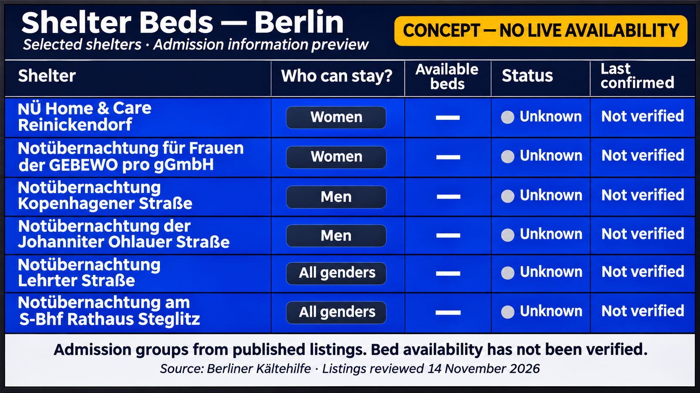

# Berlin Shelter Bed Availability Board

Planning repository for a public information board showing Berlin shelter bed availability.

Read the [concept and requirements brief](docs/berlin-shelter-board-concept.md) for the scope, fictional examples, visual direction, freshness rules, proposed data model, and open decisions.

Current stage: concept review only. No application, live data integration, booking system, or deployment has been built.

## Visual concept

[View the improved admission board and design note](docs/shelter-board-admission-design.md).

