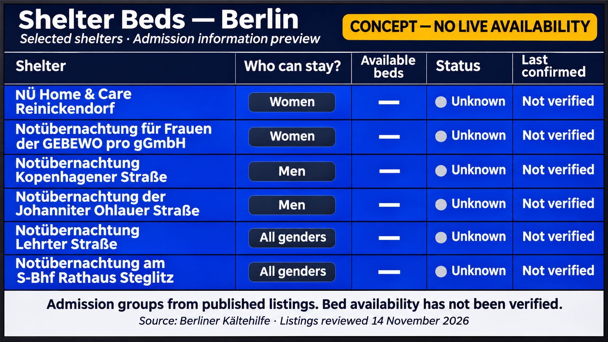

# Shelter Board Admission Concept

Created: 14 November 2026.

Visual mockup only; selected shelters, not a complete Berlin directory. No application or live integration was built.

## Design

The railway-style blue board now includes a prominent Who can stay? column, with two Women, two Men, and two All genders rows. Names retain their official German spelling; interface labels are English. All available counts are em dashes, all statuses are Unknown, and all confirmations are Not verified. Neutral badges distinguish admission information from availability. The concept notice and source footer remain visible.

## Evidence

Admission labels match the published listings reviewed earlier in this conversation on 14 November 2026:

- [Home & Care, Kopenhagener Straße, and Rathaus Steglitz](https://kaeltehilfe-berlin.de/kaeltehilfe-angebot).
- [GEBEWO women's shelter and Johanniter Ohlauer Straße](https://kaeltehilfe-berlin.de/kaeltehilfe-angebot?start=25).
- [Lehrter Straße](https://kaeltehilfe-berlin.de/kaeltehilfe-angebot?start=5).

No provider contact or new live bed check was performed for this image. Admission listings do not establish bed availability.

## Verification and limits

Visually inspected the generated image: all six names and admission groups match the approved rows; names wrap onto two lines; no visible clipping or overlapping columns; all six counts, statuses, and confirmations use the prescribed unknown values. The concept warning and source line are legible at full size. Physical screen and viewing-distance validation remain outstanding.

The image generator returned 1672 × 941 pixels, rather than the requested 1920 × 1080. The native output is preserved without resampling. The original reference image was not modified.
