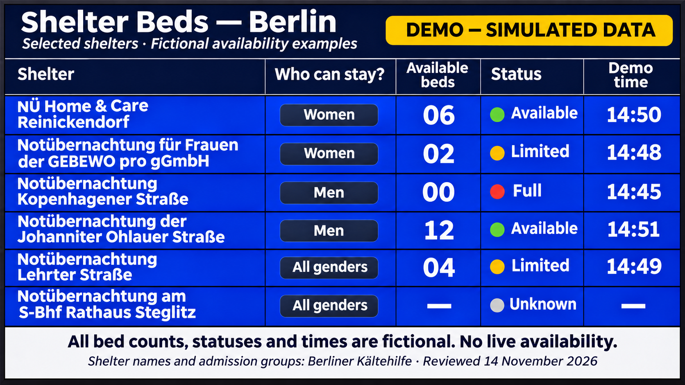

# Shelter Board with Dummy Data

Created: 14 November 2026. Static concept image only.

The user selected a static image rather than an automatically updating demo. Real shelter names and previously researched admission groups are retained. All bed counts, statuses and demo times are invented for visual demonstration. The image is labelled DEMO — SIMULATED DATA and the footer explicitly identifies fictional information.

| Row | Dummy count | Dummy status | Dummy time |
| --- | ---: | --- | --- |
| Home & Care | 06 | Available | 14:50 |
| GEBEWO women's shelter | 02 | Limited | 14:48 |
| Kopenhagener Straße | 00 | Full | 14:45 |
| Johanniter Ohlauer Straße | 12 | Available | 14:51 |
| Lehrter Straße | 04 | Limited | 14:49 |
| Rathaus Steglitz | — | Unknown | — |

Visually verified all six counts, status labels, demo times, admission labels and shelter names against the requested edit. No visible clipping or overlap. Unknown remains an em dash rather than zero. The prior concept image is preserved. No live data, application or continuous updating was added.

Admission references: [Berliner Kältehilfe directory](https://kaeltehilfe-berlin.de/kaeltehilfe-angebot), [GEBEWO and Johanniter listings](https://kaeltehilfe-berlin.de/kaeltehilfe-angebot?start=25), [Lehrter Straße listing](https://kaeltehilfe-berlin.de/kaeltehilfe-angebot?start=5), reviewed earlier on 14 November 2026. These sources do not supply the dummy availability values.
