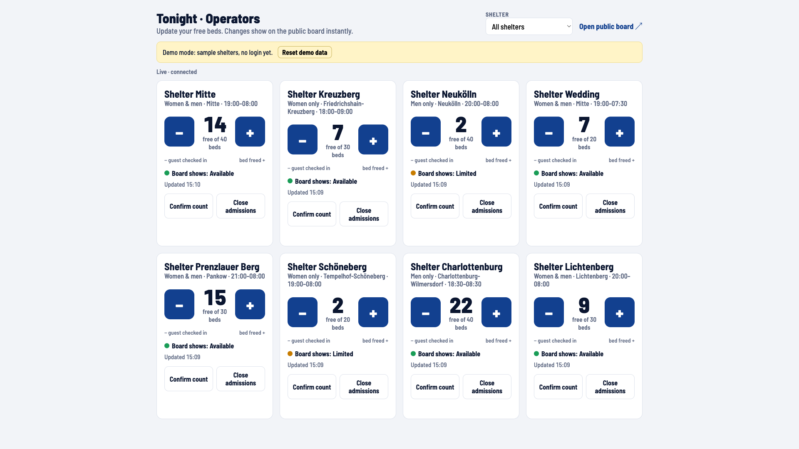

# Shelter Management Screen

The public board and management screen are included together on `claude/project-thread-d4lc8p`. The existing interface is retained.

## Open the screens

After starting the app with `npm start`:

- Management: http://localhost:3000/operator/
- Public board: http://localhost:3000/board/
- One-shelter view: http://localhost:3000/operator/?shelter=mitte

## Controls

- Select a shelter or show all shelters.
- Press minus when a guest checks in and one free bed is taken.
- Press plus when a bed becomes free.
- Press Confirm count to confirm that the displayed number is still correct.
- Close admissions or reopen admissions independently of the free-bed count.
- Open the public board to see the current shared data.
- Reset demo data restores the fictional sample records.

The screen displays admission groups, opening hours, total capacity, available beds, current status and update time. Changes are distributed through the shared server event stream.

## Verification — 14 November 2026

Opened the management screen in a browser and captured it at 1920 × 1080. Exercised the Shelter Mitte plus control and observed the public board rendering updated shared demo counts. Applied an offsetting minus update after the check. Other demo count changes occurred during the session, so the check does not establish an isolated before/after count. All seven existing API and status tests passed, including count boundaries, invalid input and subscriber updates.

This prototype uses fictional sample data and an in-memory store. There is no operator login or per-shelter access enforcement yet. This guide does not claim production readiness or verified shelter availability.
